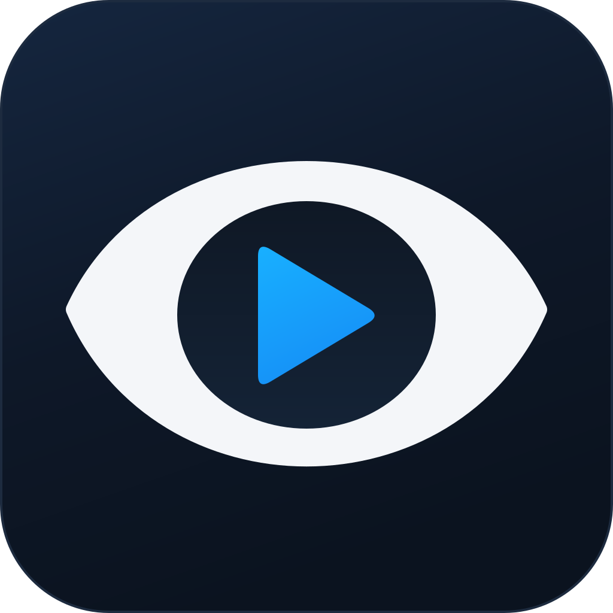
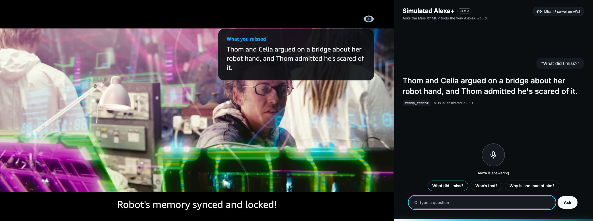
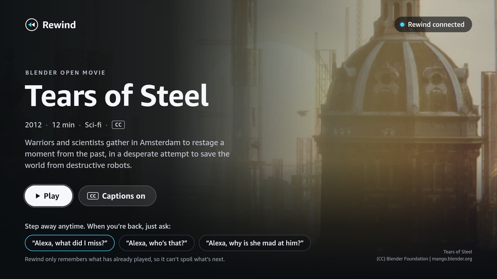
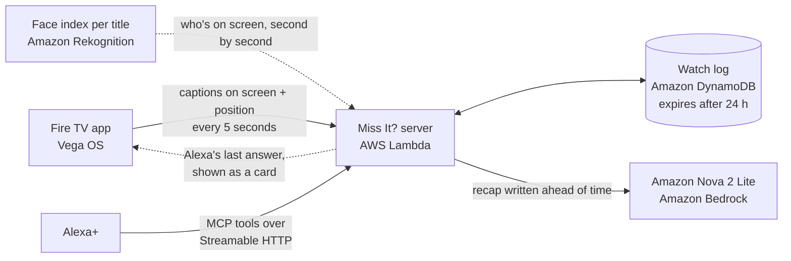

<p align="center">
  
</p>

<h1 align="center">Miss It?</h1>

<p align="center"><em>Ask what happened.</em></p>

<p align="center">
  <a href="https://github.com/vhrcam/miss-it/actions/workflows/ci.yml"></a>
</p>

**"Alexa, what did I miss?"**

Miss It? gives Alexa+ a memory of what's playing on your TV. Step away from the couch, come back, and just ask: Alexa catches you up on the scene you missed in a sentence or two, without spoilers. No remote, no pausing, no menus.

**[Watch the 2-minute demo on YouTube](https://www.youtube.com/watch?v=QRBRnJvv_d0)**

It's X-Ray, but you just talk to the room.

<p align="center">
  
  <br>
  <em>A live run: the Fire TV app (left) shows the answer while the simulated Alexa+ page (right) says it out loud.</em>
</p>

<p align="center">
  
</p>

## What you can ask

| Ask Alexa | Miss It? answers with |
|---|---|
| "What did I miss?" | A short recap of the last minute, written before you even ask |
| "Who's that?" | The character on screen, the actor, and one line on who they are *so far* |
| "Why is she mad at him?" | An answer drawn only from what has already been shown |
| "How much is left?" | What's playing, how far in you are, and the time left |
| "How does it end?" | A friendly "no spoilers", with how far you've watched |

## Spoiler-free by design

Miss It? can't spoil what it doesn't know.

1. The Fire TV app only reports captions that have **actually been on screen**. Lines skipped by fast-forwarding are never sent.
2. Every read from the watch log stops at the viewer's current position, even after a rewind. This lives in its own open-source library, [`spoiler-safe-context`](https://github.com/vhrcam/spoiler-safe-context).
3. Character bios are written per moment in the story, so "who's that?" never reveals more than you've seen.
4. The model is told to treat the transcript as everything that exists and never to guess ahead, even when it recognizes the show.
5. Questions about what comes next ("how does it end?", "does she die?") get a straight "no spoilers" before any model sees them.

## How it works



1. **The TV reports.** The [Fire TV app](firetv) plays the show and sends the captions it just displayed, plus the playback position, every few seconds. When the captions name who is talking (a WebVTT voice tag like `<v Celia>`), the name comes along, so recaps don't have to guess who said what. Most caption files don't have them, so for the demo we tagged the lines in [Tears of Steel](media/CREDITS.md) where the scene makes the speaker clear.
2. **Miss It? remembers.** The server keeps a rolling watch log per household in DynamoDB. Entries expire a day after the last update.
3. **Answers are ready before you ask.** Alexa+ expects a reply in under 500 ms, and a model call takes longer than that. So whenever new dialogue arrives, Miss It? has Amazon Nova rewrite the "last minute" recap in the background. "What did I miss?" becomes a lookup. While something is playing, the TV's regular updates also keep the Lambda function warm.
4. **"Who's that?" is precomputed too.** Miss It? indexes each title once: it grabs a frame every second from its own copy of the video, indexes every face with Amazon Rekognition, and matches them against one reference photo per character. Asking is then a lookup by timestamp.
5. **Alexa+ asks.** Miss It? is a self-hosted MCP server (Streamable HTTP, spec 2025-11-25). Alexa+ routes the question to the right tool by itself, so there's no skill name to remember.
6. **The TV shows the answer too.** Miss It? keeps Alexa's last answer, and the TV app checks for it every two seconds while the player is open. The answer pops up on a card for ten seconds, so everyone on the couch sees it, not just the person who asked.

## MCP tools

| Tool | Use it for | Notes |
|---|---|---|
| `recap_recent` | "What did I miss?", "catch me up" | Optional `seconds` (10–900, default 60). The default window is precomputed. |
| `who_is_on_screen` | "Who's that?", "who plays him?" | Character, actor, and a bio that matches the moment. |
| `ask_about_show` | "Why is she mad at him?", "where are they?" | Answers only from what has been shown. |
| `whats_playing` | "What are we watching?", "how much is left?" | Title, position, time left. |

Every tool is read-only and returns spoken text plus `structuredContent`, so screen devices can render it too. If Bedrock is unreachable, the recap and answer tools fall back to the actual dialogue instead of failing.

## AWS services

| Service | What Miss It? uses it for | Code |
|---|---|---|
| AWS Lambda | Runs the server behind a function URL: public HTTPS for the TV app and Alexa+, with no API Gateway | [`server/src/lambda.ts`](server/src/lambda.ts) |
| Amazon DynamoDB | One partition per household for the watch log, the ready recap and Alexa's last answer, all expiring a day after the last update | [`server/src/memory/dynamo-store.ts`](server/src/memory/dynamo-store.ts) |
| Amazon Bedrock | Amazon Nova 2 Lite writes recaps and answers follow-ups through the Converse API, and describes silent scenes from frames of the film | [`server/src/ai/bedrock.ts`](server/src/ai/bedrock.ts), [`server/scripts/scenes/describe.ts`](server/scripts/scenes/describe.ts) |
| Amazon Nova API | The same Nova 2 Lite with a plain API key. The live server runs on it while our new account's Bedrock quotas are still 0 ([friction log #6](docs/friction-log.md#6-bedrock-says-operation-not-allowed-on-a-new-account)) | [`server/src/ai/nova-api.ts`](server/src/ai/nova-api.ts) |
| Amazon Rekognition | Indexes every face in a title once and matches them to the cast, so "who's that?" is a lookup | [`server/scripts/faces/`](server/scripts/faces) |
| AWS CloudFormation and Amazon S3 | One command packages and deploys the whole stack | [`infra/template.yaml`](infra/template.yaml), [`infra/deploy.sh`](infra/deploy.sh) |

## Repository

| Path | What's in it |
|---|---|
| [`server/`](server) | The memory service and MCP server (TypeScript, Hono, MCP SDK, AWS SDK) |
| [`firetv/`](firetv) | The Fire TV app for Vega OS (React Native) |
| [`alexa-sim/`](alexa-sim) | A simulated Alexa+ web page that asks the Miss It? MCP tools out loud, for the demo (Alexa+ add-ons are partner-only for now) |
| [`packages/spoiler-safe-context/`](packages/spoiler-safe-context) | The open-source library behind the spoiler guarantee, also published on its own at [vhrcam/spoiler-safe-context](https://github.com/vhrcam/spoiler-safe-context) |
| [`infra/`](infra) | CloudFormation template and deploy script |
| [`docs/`](docs) | The [playback API](docs/api.md), the [friction log](docs/friction-log.md), [product feedback](docs/product-feedback.md) and the [logo](docs/brand) |
| [`media/`](media) | Fetch script and captions for the demo film |
| [`scripts/`](scripts) | The one-command demo launcher and the script that draws the logo |

## Run it locally

You need Node.js 22 or newer.

```sh
npm install
npm run dev
```

The server starts on `http://localhost:8787`, with the MCP endpoint at `/mcp`. Then play the demo film's captions into it, the same way the TV app does:

```sh
npm run simulate -w server -- --from 0 --speed 4
```

And try the tools with the [MCP Inspector](https://github.com/modelcontextprotocol/inspector):

```sh
npx @modelcontextprotocol/inspector --cli http://localhost:8787/mcp --transport http \
  --method tools/call --tool-name recap_recent
```

Or ask out loud, the way the demo does, with the [simulated Alexa+ page](alexa-sim). It needs Chrome for speech:

```sh
cd alexa-sim && npm install && npm run dev
```

Then open `http://localhost:5173`. The page talks to the Miss It? server on AWS. Add `?api=http://localhost:8787` to use your local server instead.

Recaps and answers use Amazon Nova on Bedrock when AWS credentials are available (`aws login`). If your account's Bedrock quotas are still 0, as they can be on a new account, get a key at [nova.amazon.com/dev-apis](https://nova.amazon.com/dev-apis) and set `NOVA_API_KEY` to run the same model through Amazon's direct Nova API. Set `MISS_IT_AI=off` to run with the dialogue fallback only.

## Run the demo

The whole demo runs on one Mac: the Fire TV app on the Vega Virtual Device and the simulated Alexa+ page in Chrome, both talking to the Miss It? server on AWS.

```sh
scripts/demo.sh start   # boots the virtual Fire TV, opens the app, and opens the Alexa+ page in Chrome
scripts/demo.sh play    # presses Play on the TV
scripts/demo.sh stop    # shuts everything down
```

It needs the Vega SDK, `npm install` in `firetv/` and `alexa-sim/`, and `MISS_IT_DEVICE_KEY` in `.env`. If anything is missing, it says what to do. Put the TV on the left and Chrome on the right, then ask "What did I miss?", "Who's that?" or "How does it end?"

## Deploy to AWS

```sh
aws login
echo "MISS_IT_DEVICE_KEY=$(openssl rand -hex 24)" > .env
infra/deploy.sh
```

The script builds the server, packages it, and deploys a CloudFormation stack: a Lambda function with a public HTTPS URL, a DynamoDB table with time-to-live, and permission to call Amazon Nova on Bedrock. It prints the URL to give the TV app and Alexa+. If `.env` also has `NOVA_API_KEY`, the function uses the Nova API instead of Bedrock. [`.env.example`](.env.example) lists every setting.

To build the "who's that?" index for a title:

```sh
npm run faces:index -w server -- --content tears-of-steel --video ../media/tears-of-steel.mp4
npm run faces:match -w server -- --content tears-of-steel
```

## Tests

```sh
npm test
```

The server tests cover the playback API, every MCP tool, the precomputed recaps (with a fake model), the DynamoDB store, and the real Tears of Steel cast timeline. The library tests cover parsing and the spoiler guarantee. The Fire TV app has its own tests (`cd firetv && npm test`), and CI runs everything on every push.

## Built with

Alexa+ (MCP, Streamable HTTP) · Model Context Protocol TypeScript SDK · Amazon Bedrock with Amazon Nova 2 Lite · Amazon Rekognition · AWS Lambda · Amazon DynamoDB · AWS CloudFormation · Vega OS and React Native · Hono · TypeScript

## Credits

The demo film is *Tears of Steel*, (CC) Blender Foundation, [mango.blender.org](https://mango.blender.org), licensed under [CC BY 3.0](https://creativecommons.org/licenses/by/3.0/).

## License

[MIT](LICENSE)
