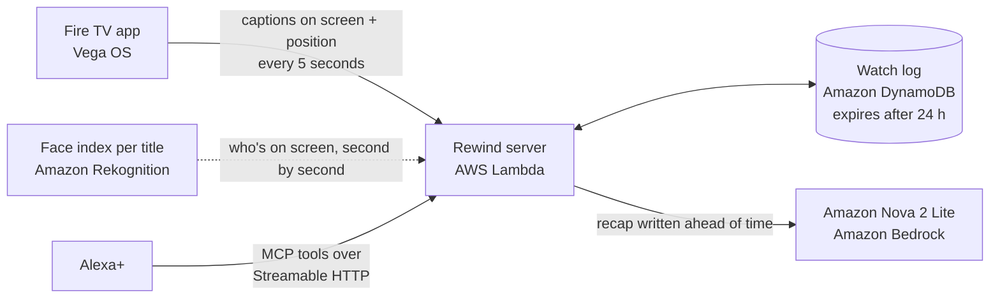

# Rewind

[](https://github.com/vhrcam/rewind/actions/workflows/ci.yml)

**"Alexa, what did I miss?"**

Rewind gives Alexa+ a memory of what's playing on your TV. Step away from the couch, come back, and just ask: Alexa catches you up on the scene you missed in a sentence or two, without spoilers. No remote, no pausing, no menus.

It's X-Ray, but you just talk to the room.

## What you can ask

| Ask Alexa | Rewind answers with |
|---|---|
| "What did I miss?" | A short recap of the last minute, written before you even ask |
| "Who's that?" | The character on screen, the actor, and one line on who they are *so far* |
| "Why is she mad at him?" | An answer drawn only from what has already been shown |
| "How much is left?" | What's playing, how far in you are, and the time left |

## Spoiler-free by design

Rewind can't spoil what it doesn't know.

1. The Fire TV app only reports captions that have **actually been on screen**. Lines skipped by fast-forwarding are never sent.
2. Every read from the watch log stops at the viewer's current position, even after a rewind. This lives in its own open-source library, [`spoiler-safe-context`](packages/spoiler-safe-context).
3. Character bios are written per moment in the story, so "who's that?" never reveals more than you've seen.
4. The model is told to treat the transcript as everything that exists and never to guess ahead, even when it recognizes the show.

## How it works



1. **The TV reports.** The [Fire TV app](firetv) plays the show and sends the captions it just displayed, plus the playback position, every few seconds.
2. **Rewind remembers.** The server keeps a rolling watch log per household in DynamoDB. Entries expire a day after the last update.
3. **Answers are ready before you ask.** Alexa+ expects a reply in under 500 ms, and a model call takes longer than that. So whenever new dialogue arrives, Rewind has Amazon Nova rewrite the "last minute" recap in the background. "What did I miss?" becomes a lookup. While something is playing, the TV's regular updates also keep the Lambda function warm.
4. **"Who's that?" is precomputed too.** Rewind indexes each title once: it grabs a frame every second from its own copy of the video, indexes every face with Amazon Rekognition, and matches them against one reference photo per character. Asking is then a lookup by timestamp.
5. **Alexa+ asks.** Rewind is a self-hosted MCP server (Streamable HTTP, spec 2025-11-25). Alexa+ routes the question to the right tool by itself, so there's no skill name to remember.

## MCP tools

| Tool | Use it for | Notes |
|---|---|---|
| `recap_recent` | "What did I miss?", "catch me up" | Optional `seconds` (10–900, default 60). The default window is precomputed. |
| `who_is_on_screen` | "Who's that?", "who plays him?" | Character, actor, and a bio that matches the moment. |
| `ask_about_show` | "Why is she mad at him?", "where are they?" | Answers only from what has been shown. |
| `whats_playing` | "What are we watching?", "how much is left?" | Title, position, time left. |

Every tool is read-only and returns spoken text plus `structuredContent`, so screen devices can render it too. If Bedrock is unreachable, the recap and answer tools fall back to the actual dialogue instead of failing.

## Repository

| Path | What's in it |
|---|---|
| [`server/`](server) | The memory service and MCP server (TypeScript, Hono, MCP SDK, AWS SDK) |
| [`firetv/`](firetv) | The Fire TV app for Vega OS (React Native) |
| [`packages/spoiler-safe-context/`](packages/spoiler-safe-context) | The open-source library behind the spoiler guarantee |
| [`infra/`](infra) | CloudFormation template and deploy script |
| [`docs/`](docs) | The [playback API](docs/api.md) and the [friction log](docs/friction-log.md) |
| [`media/`](media) | Fetch script and captions for the demo film |

## Run it locally

You need Node.js 22 or newer.

```sh
npm install
npm run dev
```

The server starts on `http://localhost:8787`, with the MCP endpoint at `/mcp`. Then play the demo film's captions into it, the same way the TV app does:

```sh
npm run simulate -w server -- --from 0 --speed 4
```

And try the tools with the [MCP Inspector](https://github.com/modelcontextprotocol/inspector):

```sh
npx @modelcontextprotocol/inspector --cli http://localhost:8787/mcp --transport http \
  --method tools/call --tool-name recap_recent
```

Recaps and answers use Amazon Nova when AWS credentials are available (`aws login`). Set `REWIND_AI=off` to run with the dialogue fallback only.

## Deploy to AWS

```sh
aws login
echo "REWIND_DEVICE_KEY=$(openssl rand -hex 24)" > .env
infra/deploy.sh
```

The script builds the server, packages it, and deploys a CloudFormation stack: a Lambda function with a public HTTPS URL, a DynamoDB table with time-to-live, and permission to call Amazon Nova on Bedrock. It prints the URL to give the TV app and Alexa+.

To build the "who's that?" index for a title:

```sh
npm run faces:index -w server -- --content tears-of-steel --video ../media/tears-of-steel.mp4
npm run faces:match -w server -- --content tears-of-steel
```

## Tests

```sh
npm test
```

The server tests cover the playback API, every MCP tool, the precomputed recaps (with a fake model), the DynamoDB store, and the real Tears of Steel cast timeline. The library tests cover parsing and the spoiler guarantee.

## Built with

Alexa+ (MCP, Streamable HTTP) · Model Context Protocol TypeScript SDK · Amazon Bedrock with Amazon Nova 2 Lite · Amazon Rekognition · AWS Lambda · Amazon DynamoDB · AWS CloudFormation · Vega OS and React Native · Hono · TypeScript

## Credits

The demo film is *Tears of Steel*, (CC) Blender Foundation, [mango.blender.org](https://mango.blender.org), licensed under [CC BY 3.0](https://creativecommons.org/licenses/by/3.0/).

## License

[MIT](LICENSE)
