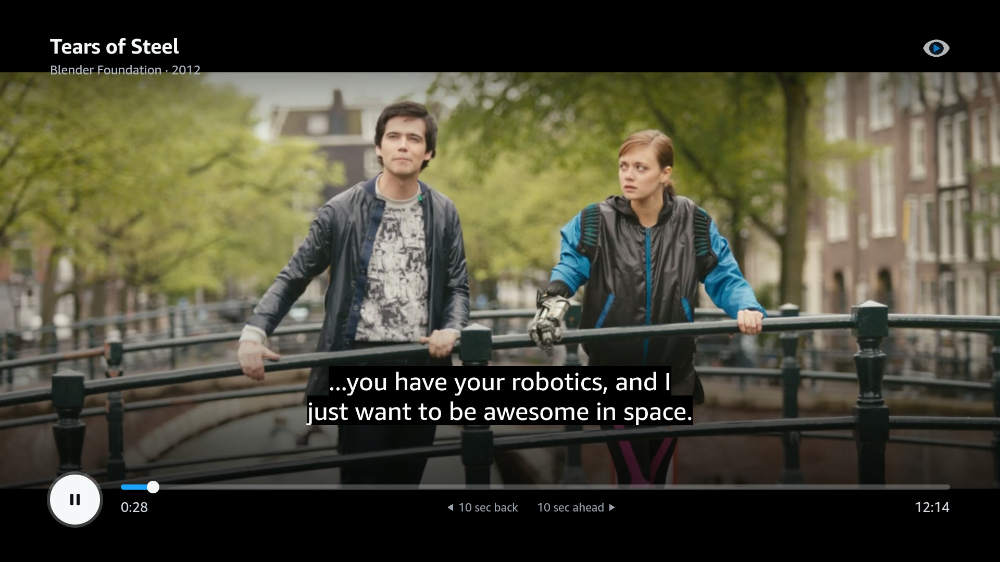
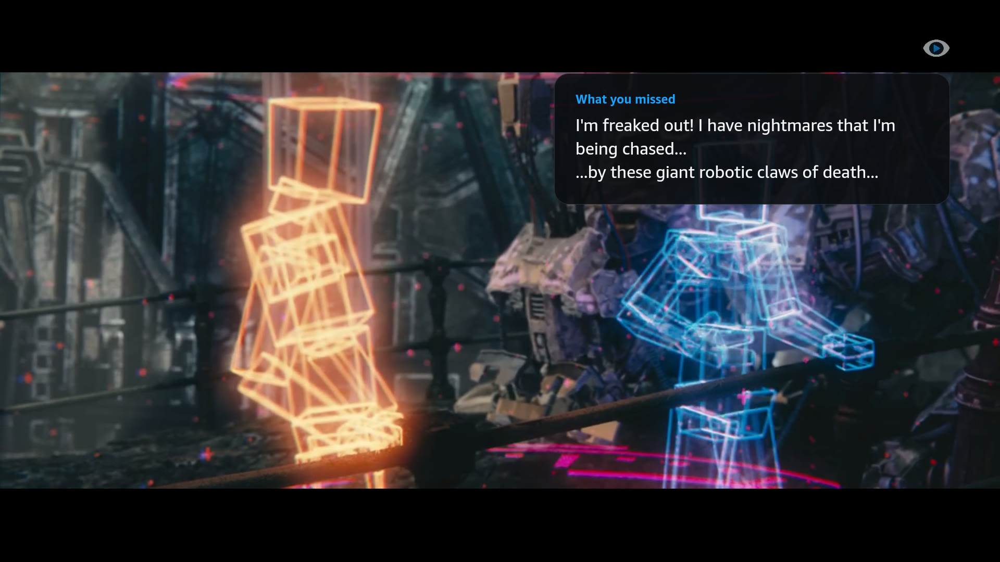

# Rewind for Fire TV

The Fire TV half of [Rewind](../README.md). It plays the show and tells the Rewind server which captions have been on screen, so Alexa can catch you up without spoilers.

It's a Vega OS app built with React Native 0.72 and Amazon's W3C media player (`@amazon-devices/react-native-w3cmedia`).


| The player, with the captions above the controls | An answer card after “Alexa, what did I miss?” |
|---|---|
|  |  |

Screenshots from the Vega Virtual Device. The card shows the recap Rewind falls back to when the model is unavailable: the last lines of dialogue.

## What it does

- Opens on a Home screen with the film, a Play button, a captions switch, and the questions you can ask Alexa.
- Plays *Tears of Steel* with English captions. The film streams over HTTPS from Blender's mirrors, and if one fails, the next takes over. The captions are bundled into the app.
- Every 5 seconds while playing, and right away on play, pause, seek and end, it sends Rewind the playback position and the captions that appeared since the last update. The format is in the [playback API](../docs/api.md).
- When someone asks Alexa about the film, the answer shows on a card for about 10 seconds: "What you missed", "Who’s that", or the question itself. The player checks Rewind for new answers every 2 seconds.
- A badge in the top-right corner shows whether the TV is reaching Rewind: "Rewind connected", "Connecting to Rewind" or "Rewind can’t connect". It's always on the Home screen. In the player it only comes up with the controls or an answer card, so it stays out of the way while you watch.

| Remote button | On Home | In the player |
|---|---|---|
| Left, Right | Move between Play and Captions | Back or ahead 10 seconds |
| Select | Press the focused button | Play or pause |
| Play/Pause | | Play or pause |
| Rewind, Fast Forward | | Back or ahead 10 seconds |
| Up, Down | | Show the controls |
| Back | Leave the app | Back to Home |

When the controls come up, the captions move above them.

## Only what's been on screen

Rewind's spoiler guarantee starts on the TV.

- Twice a second, the app collects the captions whose start time playback just passed.
- A jump of more than 5 seconds counts as a seek. Captions skipped by a seek are never collected, so fast-forwarding past a scene keeps it out of Rewind's memory.
- Updates go out one at a time and in order, so Rewind never gets an older position after a newer one. If Rewind can't be reached, the collected captions go out with the next update.

## Requirements

- macOS with [Homebrew](https://brew.sh). These steps were tested on an Apple silicon Mac.
- Node.js 18 or newer
- About 20 GB of free disk space for the Vega SDK

## Set up

1. Install Rosetta 2 (Apple silicon only) and the tools the Vega SDK needs:

   ```sh
   [[ $(arch) == "arm64" ]] && softwareupdate --install-rosetta --agree-to-license
   brew update && brew install binutils coreutils gawk findutils grep jq lz4 gnu-sed watchman
   ```

2. Install the Vega SDK. It includes the `vega` CLI and the Vega Virtual Device, a virtual Fire TV that runs on your Mac. The installer asks a few questions; press Enter to accept the defaults.

   ```sh
   curl -fsSL https://sdk-installer.vega.labcollab.net/get_vvm.sh | bash && source ~/vega/env
   vega --version
   ```

   `vega --version` should print an `Active SDK Version` and a `Vega CLI Version`. Rewind was built with SDK 0.24.

3. Install the app's packages:

   ```sh
   cd firetv
   npm install
   ```

Run the rest of the commands from `firetv/`.

## Configure

The app reads two settings from the `.env` file in the repo root, the same file `infra/deploy.sh` uses:

| Variable | Default | What it's for |
|---|---|---|
| `MISS_IT_API_URL` | The Rewind server on AWS Lambda | Where the app sends playback updates |
| `MISS_IT_DEVICE_KEY` | `dev-device-key`, which only a local server accepts | The key the server checks on every request |

Before each build, `scripts/write-env.js` writes them into `src/env.ts`. Git ignores that file, so the key never lands in the repo. Environment variables override `.env`. After changing either setting, build again.

## Build

```sh
npm run build:release
```

On an Apple silicon Mac, the package for the virtual device is `build/aarch64-release/rewind-firetv_aarch64.vpkg`. The same build makes `x86_64-release` for Intel Macs and `armv7-release` for a Fire TV Stick.

## Run it on the Vega Virtual Device

```sh
vega virtual-device start --timeout 300
vega run-app build/aarch64-release/rewind-firetv_aarch64.vpkg com.vhrcam.rewind.main --deviceId VirtualDevice
```

The first boot can be slow, so `--timeout` raises the wait from the default 60 seconds. `run-app` installs the app and opens it on the Home screen.

To press remote buttons from the terminal, for example Select:

```sh
vega device run-cmd -c 'inputd-cli button_press KEY_ENTER'
```

`KEY_LEFT`, `KEY_RIGHT`, `KEY_UP` and `KEY_DOWN` work the same way.

To restart the app without reinstalling it:

```sh
vega device terminate-app --appName com.vhrcam.rewind.main
vega device launch-app --appName com.vhrcam.rewind.main
```

When you're done:

```sh
vega virtual-device stop
```

## Check that Rewind hears it

Once the badge in the player says "Rewind connected", ask the server what it remembers. Fill in your server URL and device key:

```sh
curl -s <MISS_IT_API_URL>/v1/playback/demo -H "Authorization: Bearer <MISS_IT_DEVICE_KEY>"
```

The reply has the title, the position, how many captions Rewind has seen, the last minute of dialogue, and the recap that's ready for "what did I miss?".

On the Home screen, "Rewind connected" means the server is up and accepts the device key. The app checks every 10 seconds.

## Use a local server

Start the server from the repo root (see the [main README](../README.md#run-it-locally)):

```sh
npm run dev
```

Then, from `firetv/`, build the app against it and run it again. The virtual device reaches your Mac at `10.0.2.2`, and the local server accepts `dev-device-key` unless you set `MISS_IT_DEVICE_KEY` for it.

```sh
MISS_IT_API_URL=http://10.0.2.2:8787 MISS_IT_DEVICE_KEY=dev-device-key npm run build:release
vega run-app build/aarch64-release/rewind-firetv_aarch64.vpkg com.vhrcam.rewind.main --deviceId VirtualDevice
```

Plain `http://` is fine for the server. Only the video has to be HTTPS. To check what the local server remembers:

```sh
curl -s http://localhost:8787/v1/playback/demo -H "Authorization: Bearer dev-device-key"
```

## Tests

```sh
npm test
npm run lint
npx tsc --noEmit
```

The tests cover the WebVTT parser (including the bundled Tears of Steel captions), the cue tracker (seeks never collect skipped lines), the reporter (one update at a time, in order, with captions kept after a failed send), and which answers get a card.

## Captions and images

`src/captions/tearsOfSteel.ts` is generated from [`media/tears-of-steel.en.vtt`](../media/tears-of-steel.en.vtt). After changing the WebVTT file, run:

```sh
npm run captions
```

The images in `src/assets/` are the Home backdrop, a still from the film with the shading baked in, and the fades behind the player controls. The app icon, Rewind's mark as the 512 × 512 PNG the manifest asks for, is `assets/image/rewind-icon.png`. To make them all again, download the film with `media/fetch.sh` and run:

```sh
npm run images
```

## Troubleshooting

| What you see | What to do |
|---|---|
| "Media error 4" on screen | Use an HTTPS video URL. The Vega media player rejects `http://` sources with this code, which looks like a file format error but isn't. |
| "Rewind can’t connect" | Check `MISS_IT_API_URL`, and that the device key matches the server's. A wrong key gets a 401. Then build and run the app again. |
| No answer card after asking Alexa | The card only shows answers from the last 30 seconds, and only while the player is open. “What are we watching?” never gets one, since the controls already show it. |
| `vega virtual-device start` keeps waiting after the device window closed | Stop it with Ctrl+C and run it again. |

What else tripped us up building for Vega, with workarounds, is in the [friction log](../docs/friction-log.md#fire-tv-vega-sdk).

## Project layout

| Path | What's in it |
|---|---|
| `src/screens/HomeScreen.tsx` | The Home screen: Play, the captions switch and the Alexa hints |
| `src/screens/PlayerScreen.tsx` | The player: video, captions, controls and the remote |
| `src/components/` | The Rewind badge, the answer card, the logo, and triangles drawn with views |
| `src/player/usePlayback.ts` | Runs the media player: mirrors and retries, captions, and the updates |
| `src/playback/CueTracker.ts` | Collects the captions that were actually on screen |
| `src/playback/PlaybackReporter.ts` | Sends the updates to Rewind, in order |
| `src/rewind/` | Gets Alexa's latest answer for the card, which also tells the Home badge the server is up |
| `src/captions/webvtt.ts` | WebVTT parser |
| `src/config.ts` | The film, its mirrors and the Rewind settings |
| `src/theme.ts` | The colors from the design mock |
| `scripts/` | Build-time scripts for `.env` and the captions, and the image script |
| `test/` | Unit tests |
| `manifest.toml` | Vega app manifest (`com.vhrcam.rewind`) |

## Credits

*Tears of Steel* is (CC) Blender Foundation, [mango.blender.org](https://mango.blender.org), licensed under [CC BY 3.0](https://creativecommons.org/licenses/by/3.0/). Details are in [media/CREDITS.md](../media/CREDITS.md).
